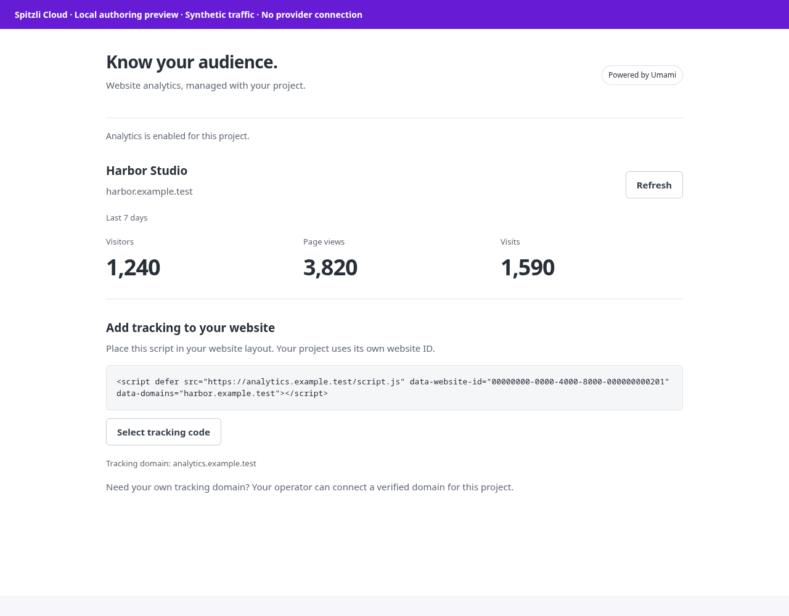

# Managed Analytics


Add project-scoped website analytics using the managed Umami integration.

## What you can do

Enable one website per project, retrieve its tracking snippet and inspect visitors, page views and visits.

## Setup and access

Operator-managed alpha. Requires an installed runtime, project grant and named provider binding. Copy the returned project script into your website. A custom tracking domain needs explicit DNS verification and operator routing/TLS setup.

## Data and security

Provider credentials stay in the host binding; Core stores the project mapping. The tracking script sends website analytics to the configured provider. Review your website’s privacy and consent requirements before enabling collection.

## Status and limits

Alpha. Custom-domain setup is operator-managed; no self-service domain automation is claimed. Statistics depend on the provider and selected time window. Synthetic gallery counts are UI examples, not measured traffic.

Catalog publication does not activate the plugin, enable public signup or grant
access to any customer resource. A new presentation release must use a new version;
previously signed releases and their assets stay immutable.

## Gallery

Actual sandboxed analytics UI with synthetic counts and tracking configuration. No traffic was collected or provider contacted.



## Catalog source

`.tabularium` is the complete catalog-refresh source. It retains the immutable
runtime image and full protocol/access contract of the currently released
`0.1.0-alpha.3` and adds the prepared presentation assets. Refresh it only from a
reviewed immutable source commit. This does not replace signed release assets
or activate the runtime.

## Technical reference

The retained implementation notes below include platform integration procedures.
Commands referring to Core, `tools/` or `apps/console` require the [platform source
checkout](https://github.com/spitzli/webdock); they are not standalone setup steps.

An external Webdock extension backed by Umami. The ElysiaJS runtime provides one action implementation for Console, HTTP API and MCP.

Operator-managed alpha: deployed as a real external plugin and used by the Webdock homepage. The host enforces project grants and private runtime TLS.

- Enable one analytics website per project, with retry-safe deterministic identity.
- Retrieve the tracking script configuration and website statistics.
- Project-specific provider credentials remain in the Webdock host's named HTTP binding.
- Core data stores the project mapping; the plugin receives no database or provider passwords.

## Console panel


The screenshot shows the initial English-language project configuration before the first production page view.

## Actions and routes

| Action | HTTP route (under the host's plugin/project prefix) | MCP tool |
|---|---|---|
| `analytics.provision` | `POST /site` | `plugin__managed_analytics__provision` |
| `analytics.configuration` | `GET /configuration` | `plugin__managed_analytics__configuration` |
| `analytics.stats` | `GET /stats` | `plugin__managed_analytics__stats` |

GET requests take an `input` JSON query parameter. Mutations require `Idempotency-Key`. Authentication, current project authority, manifest capabilities and an explicit project grant are checked by the host for all transports.

## Development

```sh
npm ci
bun test
npm run build
```

The vendored SDK is a local prerelease built from the Webdock working branch. It is not an npm release. The image digest in the development manifest is replaced by `webdock plugin pack` before publishing.

## Optional custom tracking domain

Custom domains are an operator-managed option. The default remains the provider origin; Webdock itself uses `moon.webdock.dev`.

1. Generate a project-bound request with `bun scripts/domain.ts request PROJECT_ID track.customer.example moon.webdock.dev > request.json`.
2. The customer creates a CNAME from that tracking subdomain to `moon.webdock.dev` and a TXT record at `_webdock-analytics.TRACKING_DOMAIN` containing `webdock-analytics=PROJECT_ID:TOKEN` from the request.
3. Run `bun scripts/domain.ts verify request.json`. Both DNS records must match. Preserve the request for audit.
4. Export the provider cluster's current ingress inventory, then run `bun scripts/domain.ts plan request.json target.json ingresses.json`. The target specifies the provider's namespace, service, port and namespace-scoped ACME issuer. The planner refuses a conflicting existing hostname binding. Apply the reviewed plan without overwriting another project's resource.
5. Wait for the TLS certificate and verify `/script.js` and `/api/send` through the new domain. `/login`, `/api/websites` and `/` must remain unavailable: the generated ingress exposes only the two exact collection paths.
6. In the host's private runtime settings, set `publicConfiguration[PROJECT_ID].tracking_origin` to the verified HTTPS origin. The host selects only the current project's override and validates it against the plugin manifest. Reload the plugin panel and install its returned script configuration.

This does not automatically change a customer's DNS or expose provider administration. The DNS/route/TLS step requires the operator; self-service domain automation is not claimed.

## Blacksmith CI

The Blacksmith GitHub App is installed for the exact 16 Spitzli platform, plugin and SDK repositories. The configured and observed region is `us-west`, under the owner’s EU-only exception for Spitzli’s own GitHub CI. The official managed-builder probe passed with `nofallback: true`. These prepared workflows use only Blacksmith; actual per-repository source checks and publication of the regular workflows remain pending. Provider and customer credentials are not used for source checks, and no builder fallback is allowed.

The prepared manual `Plugin Blacksmith build` workflow can push a checked image candidate by enabling `publish_image`. It records the immutable image/source identity; existing versioned registry manifests and releases are unchanged. A new registry version still requires its proper manifest and signed integrity verification.
